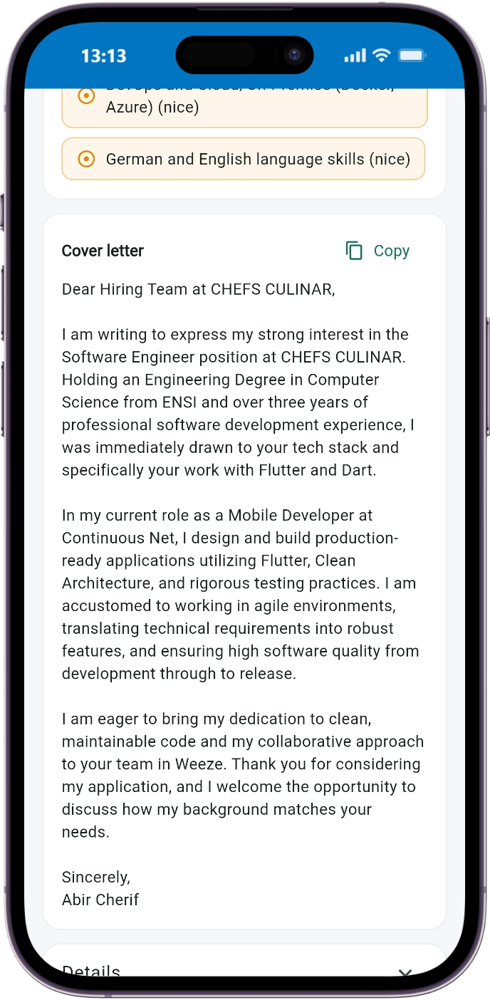

# Job Fit

Paste a job description and get a clear answer: **apply or not**.

Job Fit compares a job ad with my CV, like an ATS check. It shows a match score, a verdict, the skills that match or are missing, tips to adapt my CV, and a ready-to-copy cover letter. It also keeps a small application tracker.

**Live demo:** https://abir739.github.io/job-fit/

<p align="center">
  
  
  
  
</p>

## Features

- **Match score and verdict:** a 0–100% score and APPLY / APPLY WITH CAUTION / SKIP, plus the reasons and any blockers (seniority, location, visa…).
- **Skills breakdown:** matched, partly matched and missing skills, each with the evidence from the CV.
- **CV tips:** concrete keywords and experience to highlight for this specific job.
- **Cover letter:** a short cover letter written from real CV facts only, with one-tap copy.
- **History and tracker:** every evaluated job is saved, and synced between phone and computer. Mark each one Saved, Applied, Interview, Rejected or Offer.

## How it works

```
Flutter web app ──► Supabase Edge Function ──► Gemini API
      ▲                     │
      │                     ▼
 score + verdict      Postgres (history)
 (pure Dart rules)
```

- **The AI only extracts facts.** It returns structured JSON (requirements, match level, blockers) that follows a strict schema.
- **The decision is plain code.** The score and verdict are computed in pure Dart with fixed rules, so the same facts always give the same answer, and the rules are unit tested.
- **Private data stays on the server.** The CV and the evaluation rules live in a locked database table that only the Edge Function can read. The AI key is a server secret, never shipped to the browser.
- **Resilient AI calls.** If a model is busy or slow, the function falls back to the next model after a timeout.

## Tech stack

| Part | Tech |
|---|---|
| App (web, works on phone) | Flutter 3, Dart, Riverpod 3 |
| Backend | Supabase Edge Function (Deno, TypeScript), Postgres with Row Level Security |
| AI | Google Gemini, structured JSON output, behind a provider interface |
| Tests | `flutter_test`, widget tests, `MockClient` for HTTP |
| CI/CD | GitHub Actions: analyze, test, build, deploy to GitHub Pages |

## Project structure

```
lib/
  scoring/        score and verdict rules (pure Dart)
  ai/             analyzer interface, Edge Function client, fake for tests
  evaluation/     Riverpod controller
  history/        saved jobs and application status
  cover_letter/   cover letter client
  ui/             pages and widgets
supabase/
  functions/analyze-job/   Edge Function
  setup.sql                tables and permissions
test/             unit and widget tests
```

## Run locally

```bash
flutter pub get
flutter test
flutter run -d chrome          # runs with fake sample data, no server needed
```

To use a real backend, pass `--dart-define=SUPABASE_URL=...` and `--dart-define=JOB_FUNCTION=...`.
